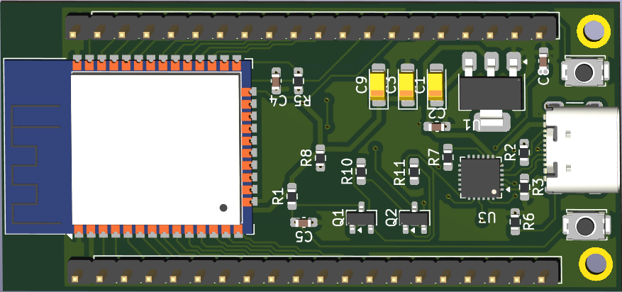
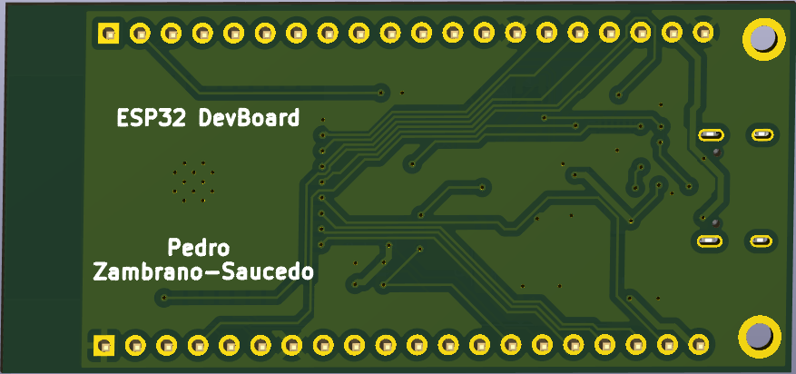
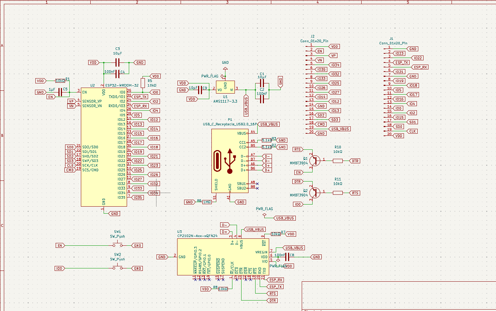
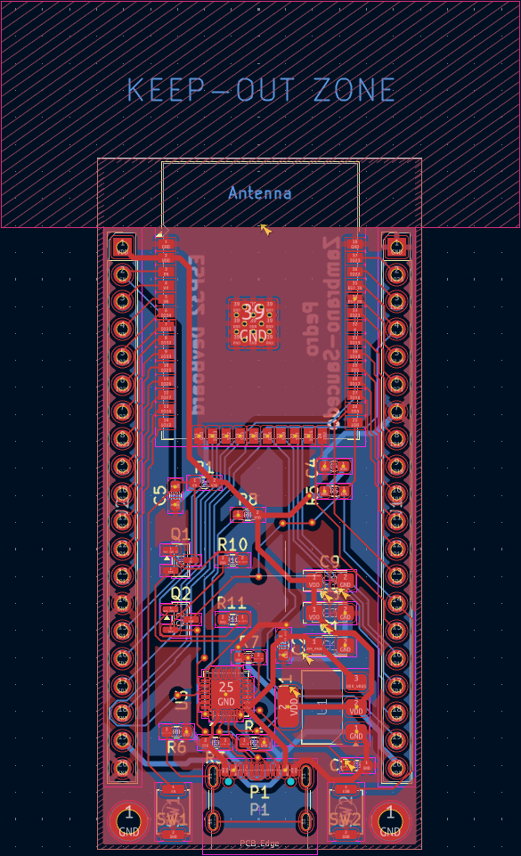
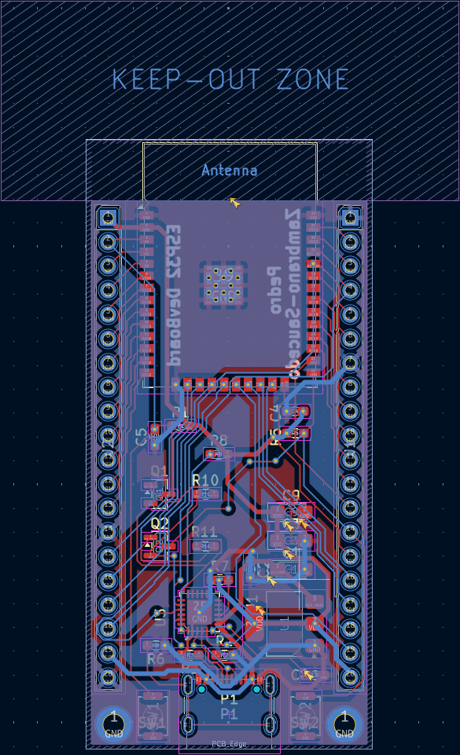

# ESP32 Development Board (KiCad)

A two-layer ESP32-WROOM-32 development board designed from a blank schematic: USB-C, an AMS1117-3.3 regulator, a CP2102N USB-UART bridge with two-transistor auto-reset, and two breadboard-spaced 20-pin headers. It's sized for hand assembly: 0603 passives, 1206 tantalums, 2.54 mm headers.

**Status: Rev B layout complete, not yet fabricated.** Rev A was cancelled before production after a design review found three faults (below). Bring-up results will be added here once the boards arrive.

| Top | Bottom |
|---|---|
|  |  |

## Specs

| | |
|---|---|
| Board | 30.0 × 64.0 mm, 2 layers, GND pour on both layers |
| MCU | ESP32-WROOM-32 (antenna keep-out on every layer, no copper under the antenna) |
| USB | USB-C receptacle (GCT USB4105), USB 2.0, 5.1 kΩ on CC1 and CC2 so it works either way up |
| USB-UART | CP2102N (QFN-24), DTR/RTS auto-reset through two MMBT3904s |
| Power | 5 V USB → AMS1117-3.3, 10 µF tantalum in and out, 100 nF decoupling at each IC |
| I/O | 2 × 20-pin 2.54 mm headers, rows 25.4 mm apart (fits a breadboard) |
| Buttons | EN (reset) and IO0 (boot) |
| Routing | 0.25 mm signals, 0.5 mm power (USB_VBUS, VDD, GND), necked down to 0.2 mm at fine-pitch pins |

## How it works

```
USB-C ─┬─ VBUS ──┬─ AMS1117-3.3 ── VDD (3.3 V) ─┬─ ESP32-WROOM-32
       │         └─ CP2102N VREGIN / VBUS        └─ CP2102N VIO, pull-ups, headers
       ├─ D+/D− ─── CP2102N ── TXD/RXD ───────────── ESP32 RXD0/TXD0
       │                    └─ DTR/RTS ─ Q1/Q2 ──── EN / IO0   (auto-reset into bootloader)
       └─ CC1/CC2 ─ 5.1 kΩ each to GND (identifies the board as a USB sink)
```



## Rev A → Rev B: what broke and what I changed

Rev A was laid out and submitted to JLCPCB. A net-by-net review of the board file found three faults, so I cancelled the order before it went into production.

| # | Rev A fault | Why it was missed | Rev B fix |
|---|---|---|---|
| 1 | **The 3.3 V regulator had no input.** USB 5 V (`USB_VBUS`) only reached the CP2102N's VREGIN pin. The AMS1117's input was on a separate net (`UART_VBUS`) tied only to the CP2102N's VBUS *sense* pin. The input caps were in series instead of to GND. The board would never have powered on. | A `PWR_FLAG` on the regulator input told ERC the net was powered, which hid the error. | USB 5 V feeds the regulator and both CP2102N VBUS pins, the caps go to GND, and the masking `PWR_FLAG` is removed. |
| 2 | **The reset and boot buttons did nothing.** Each switch pulled EN or IO0 to GND through a reverse-biased LED, so the pin never went low. | ERC can't see it: every connection is valid, only the diode direction is wrong. | The switches go directly to EN and IO0, and the LEDs are removed. |
| 3 | **Auto-reset was AC-coupled.** The transistor bases were driven through 100 nF capacitors instead of resistors, giving only edge pulses where esptool needs IO0 held low while EN rises. | ERC can't see it: the topology is right, only the component type is wrong. | 10 kΩ base resistors (R10, R11). |

Also changed for Rev B:
- **USB-C plug → receptacle,** so it works with a normal cable. CC1 and CC2 each have their own 5.1 kΩ, and both D+/D− contact pairs are tied.
- **1.00 mm → 2.54 mm headers.** The 1 mm headers had 0.15 mm between pads, far below JLCPCB's 0.5 mm minimum for through-holes, and wouldn't fit a breadboard.
- **0201 resistors and 1808 caps → 0603, and 10 µF electrolytics → 1206 tantalums,** for hand soldering.
- **ESP32 ground-pad vias 0.2 → 0.3 mm,** JLCPCB's 2-layer minimum.
- **EN RC 10 kΩ / 1 µF,** as Espressif recommends.
- **GND pour on both layers,** replacing a front-only pour that had broken into islands.

The original Rev A schematic is kept in [`hardware/rev-a/`](hardware/rev-a), with a [screenshot](docs/images/schematic-rev-a.png), for comparison.

| Layout, front copper | Layout, back copper |
|---|---|
|  |  |

## Verification so far

- **ERC:** re-run on the final schematic before fabrication.
- **DRC:** 0 errors, 0 unconnected items. Accepted violations, each documented:
  - **4 × hole clearance:** the USB4105's GND pads sit 0.19 mm from its own plastic locating-peg holes in the manufacturer footprint. JLCPCB trims copper around non-plated holes.
  - **1 × library mismatch on U2:** from the deliberate via-drill change.
- **Independent net check:** a script compared every pad on the board against the schematic netlist (62 nets, 0 mismatches) and confirmed every net is fully connected in copper.
- **Not yet verified:** fabrication, assembly and power-up. Planned bring-up:
  1. Check 3.3 V with no ESP32 fitted.
  2. Check the CP2102N enumerates.
  3. Scope EN and IO0 during an auto-reset.
  4. Flash a blink sketch.

## Bill of materials

| Ref | Value | Footprint | Qty |
|---|---|---|---|
| U2 | ESP32-WROOM-32 | `RF_Module:ESP32-WROOM-32` | 1 |
| U3 | CP2102N (e.g. CP2102N-A02-GQFN24) | `QFN-24-1EP_4x4mm_P0.5mm_EP2.6x2.6mm` | 1 |
| U1 | AMS1117-3.3 | `SOT-223-3_TabPin2` | 1 |
| P1 | USB-C receptacle, 16-pin (GCT USB4105-GF-A) | `USB_C_Receptacle_GCT_USB4105-xx-A_16P_TopMnt_Horizontal` | 1 |
| Q1, Q2 | MMBT3904 | `SOT-23` | 2 |
| C1, C3, C9 | 10 µF tantalum (C1 ≥ 16 V, C3/C9 ≥ 10 V) | `CP_EIA-3216-18_Kemet-A_HandSolder` | 3 |
| C2, C4, C8 | 100 nF | `C_0603_1608Metric` | 3 |
| C5 | 1 µF | `C_0603_1608Metric` | 1 |
| R1, R5, R7, R8, R10, R11 | 10 kΩ | `R_0603_1608Metric` | 6 |
| R2, R3 | 5.1 kΩ | `R_0603_1608Metric` | 2 |
| R6 | 1 MΩ | `R_0603_1608Metric` | 1 |
| SW1, SW2 | Tactile switch (Alps SKRK) | `SW_Push_SPST_NO_Alps_SKRK` | 2 |
| J1, J2 | 1×20 male header, 2.54 mm | `PinHeader_1x20_P2.54mm_Vertical` | 2 |

## Open the project

KiCad 9. Open `hardware/Customized ESP-32.kicad_pro`; open the schematic and board through the project so they stay linked.

```
hardware/
  Customized ESP-32.kicad_pro   project
  Customized ESP-32.kicad_sch   schematic (rev B)
  Customized ESP-32.kicad_pcb   board (rev B)
  Customized ESP-32.kicad_dru   custom design rules
  rev-a/                        original rev A schematic, kept for comparison
docs/images/                    renders, layout and schematic screenshots
```

---
Pedro Zambrano-Saucedo · Electrical Engineering, UTEP · [Portfolio](https://pazambranosauc.github.io/pazambranosauc/)
